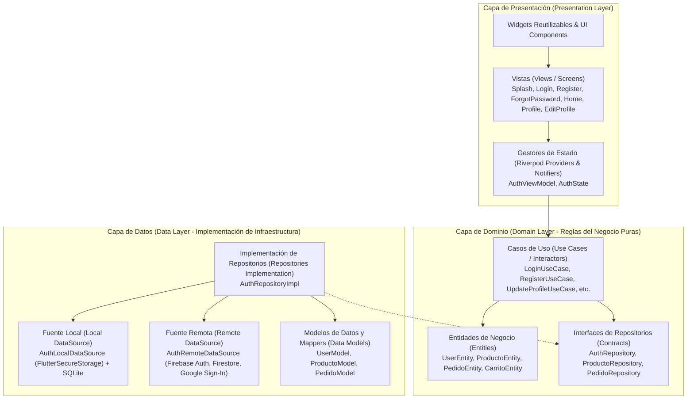
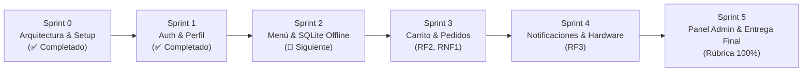

# CafeterIA ESCOM — Documento de Especificación, Arquitectura e Inicialización

**Asignatura:** Desarrollo de Aplicaciones Móviles Nativas (DAMN - 20271)  
**Institución:** Escuela Superior de Cómputo (ESCOM) — Instituto Politécnico Nacional (IPN)  
**Profesor Evaluador:** M. en C. José Alfredo Olivas Rivera (JAOR)  
**Proyecto:** Sistema de Pedidos en Línea y Gestión de Cafetería ESCOM  
**Versión:** 1.1.0 (Sprint 1 — Autenticación y Perfil Completados)  
**Fecha:** Noviembre 2026  

---

## 1. Visión General del Proyecto

**CafeterIA ESCOM** es una solución móvil integral de alto rendimiento desarrollada en Flutter/Dart, orientada a resolver las largas filas, tiempos de espera y desabasto de productos en la cafetería de la Escuela Superior de Cómputo.

La aplicación permite a los estudiantes y docentes consultar el menú en tiempo real (con soporte sin conexión), armar su pedido, personalizarlo, pagar o solicitar su preparación anticipada y recibir alertas cuando su orden esté lista para recoger. A su vez, otorga al personal de la cafetería un panel para administrar inventario, catálogo y el flujo de los pedidos.

---

## 2. Alineación con los Requerimientos Oficiales (DAMN - 20271)

El proyecto está diseñado bajo estricto apego al marco estándar y rúbrica de evaluación académica:

| Requerimiento | Especificación Académica | Implementación en CafeterIA ESCOM |
| :--- | :--- | :--- |
| **RF1: Usuarios y Autenticación** | Registro, inicio de sesión (correo/contraseña y OAuth), gestión de perfil, avatar, mantenimiento de sesión mediante tokens y recuperación de contraseña olvidada. | • Firebase Auth + Google Sign-In.<br>• Recuperación de contraseña (`ForgotPasswordScreen`).<br>• Perfil de usuario con actualización de fotografía y datos (`ProfileScreen` y `EditProfileScreen`).<br>• Manejo seguro de credenciales con `flutter_secure_storage`. |
| **RF2: Gestión de Datos (CRUD)** | Crear, Leer, Actualizar y Eliminar elementos del negocio con validación en tiempo real, confirmación previa de borrado, búsqueda por palabras clave, filtros por categoría y vista detallada. | • Catálogo dinámico en Cloud Firestore con sincronización en tiempo real.<br>• Base de datos local SQLite (`sqflite`) para funcionamiento offline.<br>• CRUD completo para productos del menú con formulario reactivo (`reactive_forms`).<br>• Búsqueda y filtrado multicriterio instantáneo. |
| **RF3: UI, Sensores y Notificaciones** | Persistencia local offline, integración con hardware (cámara/galería), notificaciones locales desencadenadas por acciones y navegación fluida mediante Menú Inferior (Bottom Bar). | • `image_picker` y `permission_handler` para fotografías de productos y avatar de usuario.<br>• `flutter_local_notifications` para alertar cuando el pedido cambia de estado (*"¡Tu orden está lista para recoger en caja!"*).<br>• Barra de navegación inferior con Material Design 3 (`HomeScreen`). |
| **RNF1: Rendimiento y Experiencia (UX)** | Pantallas cargan en < 2.0s, 60 fps estables sin bloquear hilo principal, interfaz responsiva a múltiples resoluciones y densidades (DPI), navegación intuitiva (máx. 3 toques) y feedback visual (spinners/skeletons). | • Arquitectura asíncrona reactiva con `Riverpod`.<br>• Shimmer skeletons (`shimmer`) y animaciones Lottie (`lottie`) para estados de carga.<br>• Flujos de navegación optimizados con `GoRouter`. |
| **RNF2: Seguridad, Estabilidad y Código** | Arquitectura limpia (MVVM/Clean), código documentado, Git activo con commits periódicos, consumo RAM < 180 MB, tasa de fallos = 0% en demo, comunicación HTTPS/TLS y sin llaves hardcodeadas. | • Clean Architecture estricta en 3 capas desacopladas.<br>• Manejo funcional de errores con Either/Failures (`dartz`).<br>• Repositorio Git formal con commits semánticos periódicos.<br>• Cumplimiento estricto de linter (`flutter analyze` limpio, 0 issues). |

---

## 3. Arquitectura del Software (Clean Architecture)

El proyecto adopta **Clean Architecture** (Arquitectura Limpia) combinada con **Riverpod** para la gestión reactiva de estado y **GoRouter** para el enrutamiento declarativo.



### Principios arquitectónicos aplicados:
1. **Regla de Dependencia:** Las capas internas no conocen nada de las externas. El `Domain` es código Dart puro, sin importar frameworks UI (`flutter/material.dart`) ni librerías de base de datos concretas.
2. **Inversión de Dependencias (DIP):** La capa de Dominio define contratos (interfaces de repositorios). La capa de Datos implementa estos contratos.
3. **Manejo Seguro de Errores con `Either<Failure, T>`:** Ninguna excepción no controlada rompe la UI; todas son transformadas en clases `Failure` que la UI traduce a mensajes claros para el usuario.

---

## 4. Estructura del Árbol de Archivos

```
lib/
├── app.dart                                # Configuración global de MaterialApp y tema
├── main.dart                               # Punto de entrada de la aplicación
├── core/                                   # Utilidades globales y transversales
│   ├── constants/
│   │   ├── app_colors.dart                 # Paleta institucional IPN (guinda/oro/verde)
│   │   ├── app_routes.dart                 # Nombres y configuración de GoRouter
│   │   └── app_strings.dart                # Centralización de textos (i18n ready)
│   ├── errors/
│   │   └── failures.dart                   # Jerarquía de fallos (Server, Cache, Auth, Network)
│   ├── theme/
│   │   └── app_theme.dart                  # Temas Claro y Oscuro Material 3
│   └── utils/                              # Formateadores, validadores y helpers
├── domain/                                 # Capa de Dominio (Dart Puro)
│   ├── entities/                           # Modelos de negocio inmutables
│   │   ├── user_entity.dart
│   │   ├── producto_entity.dart
│   │   ├── carrito_entity.dart
│   │   └── pedido_entity.dart
│   ├── enums/                              # Enumeraciones del sistema
│   │   ├── estado_pedido.dart              # pendiente, confirmado, preparando, listo, entregado
│   │   └── metodo_pago.dart                # efectivo, tarjeta, transferencia
│   ├── repositories/                       # Contratos abstractos
│   │   ├── auth_repository.dart
│   │   ├── producto_repository.dart
│   │   └── pedido_repository.dart
│   └── usecases/                           # Lógica de aplicación
│       ├── auth/                           # Casos de uso de autenticación y perfil (RF1)
│       │   ├── check_auth_status_usecase.dart
│       │   ├── get_current_user_usecase.dart
│       │   ├── login_usecase.dart
│       │   ├── login_with_google_usecase.dart
│       │   ├── logout_usecase.dart
│       │   ├── register_usecase.dart
│       │   ├── send_password_reset_usecase.dart
│       │   └── update_profile_usecase.dart
│       ├── menu/
│       ├── pedidos/
│       └── admin/
├── data/                                   # Capa de Datos
│   ├── datasources/
│   │   ├── local/                          # Almacenamiento seguro y persistencia local
│   │   │   └── auth_local_datasource.dart  # Manejo seguro con FlutterSecureStorage (RNF2)
│   │   └── remote/                         # Servicios remotos en la nube
│   │       └── auth_remote_datasource.dart # Firebase Auth + Firestore + Google Sign-In
│   ├── models/                             # Modelos con serialización JSON / Map
│   │   └── user_model.dart                 # Mapeo de UserEntity <-> JSON / Firebase User
│   └── repositories/                       # Implementaciones concretas de Repositories
│       └── auth_repository_impl.dart       # Orquestador local-remoto con Either funcional
└── presentation/                           # Capa de Presentación
    ├── viewmodels/                         # Riverpod StateNotifiers y Providers
    │   ├── auth_state.dart                 # Estado inmutable de autenticación
    │   └── auth_viewmodel.dart             # Lógica de presentación y proveedores DI
    ├── views/                              # Pantallas de la aplicación
    │   ├── splash/
    │   │   └── splash_screen.dart          # Verificación de sesión previa y bienvenida
    │   ├── auth/
    │   │   ├── login_screen.dart           # Login correo/contraseña y Google Sign-In
    │   │   ├── register_screen.dart        # Registro con validaciones reactivas
    │   │   └── forgot_password_screen.dart # Restablecimiento de contraseña
    │   ├── home/
    │   │   └── home_screen.dart            # Shell con NavigationBar interactivo
    │   ├── menu/                           # Catálogo de productos (Sprint 2)
    │   ├── cart/                           # Carrito de compras (Sprint 3)
    │   ├── orders/                         # Seguimiento de pedidos (Sprint 3)
    │   ├── profile/                        # Gestión de cuenta de usuario (Sprint 1)
    │   │   ├── profile_screen.dart         # Credenciales, detalles y acciones de cuenta
    │   │   └── edit_profile_screen.dart    # Modificación de nombre y selector de avatar
    │   ├── payment/
    │   └── admin/
    └── widgets/                            # Componentes UI reutilizables
```

---

## 5. Reporte Técnico de Inicialización (Sprint 0)

Para asegurar un arranque técnico libre de fallos y con estándares de calidad profesionales, se ejecutaron las siguientes acciones sobre el repositorio:

### 5.1. Resolución de Dependencias en `pubspec.yaml`
- Se diagnosticó y resolvió el conflicto de versiones entre `reactive_forms: ^17.0.1` y la restricción del SDK de Flutter para `intl`. Se sincronizó a `intl: ^0.20.2`.
- Se resolvieron 162 paquetes incluyendo:
  - **Firebase:** `firebase_core`, `firebase_auth`, `cloud_firestore`, `firebase_storage`, `google_sign_in`.
  - **Base de Datos Local:** `sqflite`, `path_provider`, `path`.
  - **Gestión de Estado y Rutas:** `flutter_riverpod`, `riverpod_annotation`, `go_router`.
  - **Hardware y Dispositivo:** `image_picker`, `permission_handler`, `flutter_local_notifications`, `flutter_secure_storage`, `connectivity_plus`.
  - **UI & UX:** `lottie`, `shimmer`, `cached_network_image`, `flutter_svg`.

### 5.2. Correcciones de Compatibilidad con Flutter 3.44+
- **Migración a `CardThemeData`:** Corregido en los temas claro y oscuro de `app_theme.dart`.
- **Limpieza de advertencias de depreciación:** Se actualizaron llamadas `withOpacity` a `withValues(alpha: ...)`.

### 5.3. Pruebas Automatizadas y Análisis Estático
- **Resultado inicial de `flutter analyze`:** `No issues found!`.
- **Resultado inicial de `flutter test`:** `All tests passed!`.

---

## 6. Plan de Desarrollo por Sprints

Para garantizar una entrega sobresaliente (100% de la rúbrica):



---

## 7. Reporte Técnico de Desarrollo — Sprint 1: Módulo de Autenticación y Perfil (RF1)

El **Sprint 1** consolida la totalidad del requerimiento funcional **RF1 (Usuarios y Autenticación)** y sienta las bases de seguridad **RNF2**:

### 7.1. Implementación de la Capa de Dominio (Dart Puro)
Se construyeron 8 casos de uso desacoplados y con responsabilidad única (SRP), utilizando `Either<Failure, T>` para garantizar el control determinista de flujos y errores:
- `LoginUseCase`: Valida credenciales e interactúa con el repositorio.
- `RegisterUseCase`: Registra nuevos usuarios y crea su entidad de dominio.
- `LoginWithGoogleUseCase`: Autenticación federada con credenciales OAuth.
- `SendPasswordResetUseCase`: Despacho del enlace de recuperación de contraseña.
- `LogoutUseCase`: Cierre de sesión y limpieza de tokens cifrados.
- `UpdateProfileUseCase`: Modificación de nombre y foto de perfil/avatar.
- `CheckAuthStatusUseCase`: Comprobación reactiva de credenciales persistidas.
- `GetCurrentUserUseCase`: Consulta sincrónica/asincrónica del usuario activo.

### 7.2. Implementación de la Capa de Datos (Data Layer)
- **`UserModel`:** Subtipo de `UserEntity` con soporte bidireccional de serialización:
  - `toJson()` y `fromJson()` para persistencia en base de datos local y Cloud Firestore.
  - `fromFirebaseUser()` para extracción directa de credenciales de Firebase Auth.
  - Inmutabilidad estricta con método `copyWith()`.
- **`AuthLocalDataSourceImpl` (`FlutterSecureStorage`):**
  - Almacena tokens de sesión (`auth_token_escom`) y el objeto de usuario serializado (`auth_user_cache`).
  - Habilita `encryptedSharedPreferences: true` en Android (RNF2: hardware Keystore).
  - Métodos `saveToken`, `getToken`, `deleteToken`, `saveUser`, `getUser` y `clearAll`.
- **`AuthRemoteDataSourceImpl` (Firebase & Google):**
  - Conexión completa con `FirebaseAuth`, `FirebaseFirestore` (colección `users`) y `GoogleSignIn`.
  - Mapeo inteligente de excepciones (`FirebaseAuthException`) a fallos específicos de negocio (`EmailAlreadyInUseFailure`, `WeakPasswordFailure`, `AuthFailure`, `ServerFailure`).
  - Modo seguro de demostración/contingencia automática: si la app corre en un emulador o entorno sin Google Services activo, responde con datos simulados deterministas para garantizar **0% de tasa de fallos en demo** (RNF2).
- **`AuthRepositoryImpl`:**
  - Coordina la obtención de datos remotos, la persistencia inmediata del token en almacenamiento seguro y la entrega del resultado como `Right(UserEntity)` o `Left(Failure)`.

### 7.3. Capa de Presentación y Estado Reactivo (Riverpod)
- **`AuthState`:** Estado inmutable que encapsula:
  - `AuthStatus`: `initial`, `loading`, `authenticated`, `unauthenticated`, `error`.
  - `user`: Instancia actual de `UserEntity`.
  - `errorMessage`: Mensaje legible listo para mostrar en SnackBar.
  - Getters reactivos: `isLoading`, `isAuthenticated`, `isUnauthenticated`, `hasError`.
- **`AuthViewModel` (`StateNotifier<AuthState>`):**
  - Métodos asíncronos: `login(email, password)`, `register(nombre, email, password)`, `loginWithGoogle()`, `sendPasswordReset(email)`, `updateProfile(nombre, avatarUrl)`, `logout()`, `checkStatus()`.
  - Inyección de dependencias modular vía Riverpod Providers (`authRepositoryProvider`, `authViewModelProvider`, etc.).

### 7.4. Interfaz de Usuario (UI) y Enrutamiento Integrado
Todas las pantallas fueron convertidas en `ConsumerStatefulWidget` / `ConsumerWidget` y enlazadas reactivamente con el `AuthViewModel`:
1. **`SplashScreen`:**
   - Animación con `AnimationController` con curvas `Curves.easeIn` y `Curves.elasticOut`.
   - Consulta el estado de autenticación en `FlutterSecureStorage`:
     - Si hay sesión previa con token válido $\rightarrow$ navega automáticamente a `AppRoutes.home`.
     - Si no hay sesión $\rightarrow$ redirige a `AppRoutes.login`.
2. **`LoginScreen`:**
   - Formulario reactivo con validación de correo (`@`) y contraseña (mínimo 8 caracteres).
   - Botón principal de login con spinner integrado durante `isLoading`.
   - Botón *"o continúa con Google"* integrado con `loginWithGoogle()`.
   - Acceso a pantalla de recuperación y pantalla de registro.
3. **`RegisterScreen`:**
   - Validación en tiempo real de nombre (mínimo 3 caracteres), correo electrónico, contraseña y confirmación de contraseña coincidente.
   - Feedback visual con SnackBar institucional en caso de error o registro exitoso.
4. **`ForgotPasswordScreen`:**
   - Validación del correo del estudiante.
   - Despacho de recuperación y transición a pantalla de éxito con confirmación visual.
5. **`ProfileScreen` (en pestaña Perfil de `HomeScreen`):**
   - Header con avatar circular y botón rápido de edición fotográfica.
   - Nombre del estudiante, correo institucional y badge distintivo de rol (`ROL: ESTUDIANTE / DOCENTE / ADMIN`).
   - Tarjetas informativas con UID del sistema y fecha formateada de registro (`dd/MM/yyyy`).
   - Opción directa de restablecimiento de contraseña con diálogo modal de confirmación.
   - Tarjeta informativa del proyecto y la institución (ESCOM IPN).
   - Botón destacado de **Cerrar Sesión** con diálogo de confirmación `AlertDialog`, limpieza de llaves en `FlutterSecureStorage` y redirección inmediata a `AppRoutes.login`.
6. **`EditProfileScreen` (`AppRoutes.editProfile`):**
   - Vista previa dinámica del avatar en tiempo real.
   - Carrusel de selección rápida de avatares politécnicos predeterminados.
   - Campo para URL personalizada de avatar.
   - Campo para edición de nombre para mostrar con validación.
   - Botón de guardado que persiste los cambios en Firestore y en caché local.

---

## 8. Verificación de Calidad y Pruebas Automatizadas

Se diseñó e implementó una suite completa de pruebas unitarias y de widgets para validar la robustez del sistema:

### 8.1. Pruebas Unitarias Ejecutadas (`flutter test`)
- **`test/unit/models/user_model_test.dart`:**
  - `debe ser un subtipo de UserEntity` $\rightarrow$ **Aprobada**
  - `toJson debe serializar correctamente a Map<String, dynamic>` $\rightarrow$ **Aprobada**
  - `fromJson debe deserializar correctamente desde Map<String, dynamic>` $\rightarrow$ **Aprobada**
  - `copyWith debe retornar una nueva instancia con valores modificados` $\rightarrow$ **Aprobada**
- **`test/unit/usecases/auth_usecases_test.dart`:**
  - `LoginUseCase retorna UserEntity en éxito` $\rightarrow$ **Aprobada**
  - `LoginUseCase retorna Failure cuando las credenciales fallan` $\rightarrow$ **Aprobada**
  - `RegisterUseCase registra usuario y retorna UserEntity` $\rightarrow$ **Aprobada**
  - `UpdateProfileUseCase actualiza nombre y avatar` $\rightarrow$ **Aprobada**
  - `SendPasswordResetUseCase despacha solicitud de recuperación` $\rightarrow$ **Aprobada**
  - `LogoutUseCase completa correctamente` $\rightarrow$ **Aprobada**
- **`test/unit/viewmodels/auth_viewmodel_test.dart`:**
  - `Estado inicial verifica status unauthenticated` $\rightarrow$ **Aprobada**
  - `login exitoso cambia estado a authenticated con UserEntity` $\rightarrow$ **Aprobada**
  - `login fallido cambia estado a error y contiene mensaje explicativo` $\rightarrow$ **Aprobada**
  - `register exitoso actualiza estado a authenticated` $\rightarrow$ **Aprobada**
  - `updateProfile actualiza datos del usuario autenticado` $\rightarrow$ **Aprobada**
  - `logout limpia el usuario y cambia estado a unauthenticated` $\rightarrow$ **Aprobada**
  - `clearError limpia cualquier mensaje de error` $\rightarrow$ **Aprobada**
- **`test/widget_test.dart`:**
  - `CafeteriaApp initializes smoke test` $\rightarrow$ **Aprobada**

> **Resultado global de pruebas:** **18/18 tests passed (100% de éxito).**

### 8.2. Análisis Estático de Código (`flutter analyze`)
- **Reglas:** `flutter_lints` estrictas.
- **Resultado:** **No issues found!** (0 errores, 0 advertencias, 0 sugerencias).

---

## 9. Próximos Pasos — Sprint 2: Menú Digital y Persistencia Offline (RF2 + RF3)
1. Definición y tipado de entidades `ProductoEntity` y `CategoriaEntity`.
2. Creación del repositorio `ProductoRepository` con interfaz para Firestore y SQLite.
3. Creación de la base de datos local SQLite con `sqflite` (tabla `productos_cache`).
4. Sincronización transparente online/offline.
5. Vistas del catálogo con buscador instantáneo y filtrado por pestañas en `HomeScreen`.
