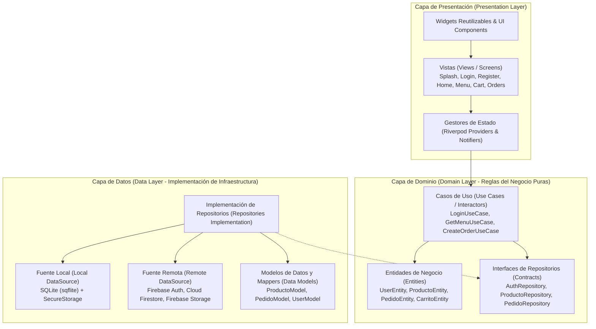
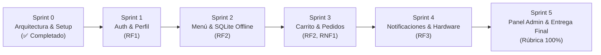

# CafeterIA ESCOM — Documento de Especificación, Arquitectura e Inicialización

**Asignatura:** Desarrollo de Aplicaciones Móviles Nativas (DAMN - 20271)  
**Institución:** Escuela Superior de Cómputo (ESCOM) — Instituto Politécnico Nacional (IPN)  
**Profesor Evaluador:** M. en C. José Alfredo Olivas Rivera (JAOR)  
**Proyecto:** Sistema de Pedidos en Línea y Gestión de Cafetería ESCOM  
**Versión:** 1.0.0-alpha (Sprint 0 — Inicialización y Arquitectura Base)  
**Fecha:** Noviembre 2026  

---

## 1. Visión General del Proyecto

**CafeterIA ESCOM** es una solución móvil integral de alto rendimiento desarrollada en Flutter/Dart, orientada a resolver las largas filas, tiempos de espera y desabasto de productos en la cafetería de la Escuela Superior de Cómputo.

La aplicación permite a los estudiantes y docentes consultar el menú en tiempo real (con soporte sin conexión), armar su pedido, personalizarlo, pagar o solicitar su preparación anticipada y recibir alertas cuando su orden esté lista para recoger. A su vez, otorga al personal de la cafetería un panel para administrar inventario, catálogo y el flujo de los pedidos.

---

## 2. Alineación con los Requerimientos Oficiales (DAMN - 20271)

El proyecto está diseñado bajo estricto apego al marco estándar y rúbrica de evaluación académica:

| Requerimiento | Especificación Académica | Implementación en CafeterIA ESCOM |
| :--- | :--- | :--- |
| **RF1: Usuarios y Autenticación** | Registro, inicio de sesión (correo/contraseña y OAuth), gestión de perfil, avatar, mantenimiento de sesión mediante tokens y recuperación de contraseña olvidada. | • Firebase Auth + Google Sign-In.<br>• Recuperación de contraseña (`ForgotPasswordScreen`).<br>• Perfil de usuario con actualización de fotografía y datos.<br>• Manejo seguro de credenciales con `flutter_secure_storage`. |
| **RF2: Gestión de Datos (CRUD)** | Crear, Leer, Actualizar y Eliminar elementos del negocio con validación en tiempo real, confirmación previa de borrado, búsqueda por palabras clave, filtros por categoría y vista detallada. | • Catálogo dinámico en Cloud Firestore con sincronización en tiempo real.<br>• Base de datos local SQLite (`sqflite`) para funcionamiento offline.<br>• CRUD completo para productos del menú con formulario reactivo (`reactive_forms`).<br>• Búsqueda y filtrado multicriterio instantáneo. |
| **RF3: UI, Sensores y Notificaciones** | Persistencia local offline, integración con hardware (cámara/galería), notificaciones locales desencadenadas por acciones y navegación fluida mediante Menú Inferior (Bottom Bar). | • `image_picker` y `permission_handler` para fotografías de productos y avatar de usuario.<br>• `flutter_local_notifications` para alertar cuando el pedido cambia de estado (*"¡Tu orden está lista para recoger en caja!"*).<br>• Barra de navegación inferior con Material Design 3 (`HomeScreen`). |
| **RNF1: Rendimiento y Experiencia (UX)** | Pantallas cargan en < 2.0s, 60 fps estables sin bloquear hilo principal, interfaz responsiva a múltiples resoluciones y densidades (DPI), navegación intuitiva (máx. 3 toques) y feedback visual (spinners/skeletons). | • Arquitectura asíncrona reactiva con `Riverpod`.<br>• Shimmer skeletons (`shimmer`) y animaciones Lottie (`lottie`) para estados de carga.<br>• Flujos de navegación optimizados con `GoRouter`. |
| **RNF2: Seguridad, Estabilidad y Código** | Arquitectura limpia (MVVM/Clean), código documentado, Git activo con commits periódicos, consumo RAM < 180 MB, tasa de fallos = 0% en demo, comunicación HTTPS/TLS y sin llaves hardcodeadas. | • Clean Architecture estricta en 3 capas desacopladas.<br>• Manejo funcional de errores con Either/Failures (`dartz`).<br>• Repositorio Git formal inicializado en branch `main`.<br>• Cumplimiento estricto de linter (`flutter analyze` limpio, 0 issues). |

---

## 3. Arquitectura del Software (Clean Architecture)

El proyecto adopta **Clean Architecture** (Arquitectura Limpia) combinada con **Riverpod** para la gestión reactiva de estado y **GoRouter** para el enrutamiento declarativo.



### Principios arquitectónicos aplicados:
1. **Regla de Dependencia:** Las capas internas no conocen nada de las externas. El `Domain` es código Dart puro, sin importar frameworks UI (`flutter/material.dart`) ni librerías de base de datos concretas.
2. **Inversión de Dependencias (DIP):** La capa de Dominio define contratos (interfaces de repositorios). La capa de Datos implementa estos contratos.
3. **Manejo Seguro de Errores con `Either<Failure, T>`:** Ninguna excepción no controlada rompe la UI; todas son transformadas en clases `Failure` que la UI traduce a mensajes claros para el usuario.

---

## 4. Estructura del Árbol de Archivos

```
lib/
├── app.dart                                # Configuración global de MaterialApp y tema
├── main.dart                               # Punto de entrada de la aplicación
├── core/                                   # Utilidades globales y transversales
│   ├── constants/
│   │   ├── app_colors.dart                 # Paleta institucional IPN (guinda/oro/verde)
│   │   ├── app_routes.dart                 # Nombres y configuración de GoRouter
│   │   └── app_strings.dart                # Centralización de textos (i18n ready)
│   ├── errors/
│   │   └── failures.dart                   # Jerarquía de fallos (Server, Cache, Auth, Network)
│   ├── theme/
│   │   └── app_theme.dart                  # Temas Claro y Oscuro Material 3
│   └── utils/                              # Formateadores, validadores y helpers
├── domain/                                 # Capa de Dominio (Dart Puro)
│   ├── entities/                           # Modelos de negocio inmutables
│   │   ├── user_entity.dart
│   │   ├── producto_entity.dart
│   │   ├── carrito_entity.dart
│   │   └── pedido_entity.dart
│   ├── enums/                              # Enumeraciones del sistema
│   │   ├── estado_pedido.dart              # pendiente, confirmado, preparando, listo, entregado
│   │   └── metodo_pago.dart                # efectivo, tarjeta, transferencia
│   ├── repositories/                       # Contratos abstractos
│   │   ├── auth_repository.dart
│   │   ├── producto_repository.dart
│   │   └── pedido_repository.dart
│   └── usecases/                           # Lógica de aplicación
│       ├── auth/
│       ├── menu/
│       ├── pedidos/
│       └── admin/
├── data/                                   # Capa de Datos
│   ├── datasources/
│   │   ├── local/                          # SQLite Database helper y DAOs
│   │   └── remote/                         # Servicios de Firebase / APIs
│   ├── models/                             # Modelos con serialización JSON / Map
│   └── repositories/                       # Implementaciones concretas de Repositories
└── presentation/                           # Capa de Presentación
    ├── viewmodels/                         # Riverpod StateNotifiers y Providers
    ├── views/                              # Pantallas de la aplicación
    │   ├── splash/splash_screen.dart
    │   ├── auth/
    │   │   ├── login_screen.dart
    │   │   ├── register_screen.dart
    │   │   └── forgot_password_screen.dart
    │   ├── home/home_screen.dart           # Shell con BottomNavigationBar
    │   ├── menu/
    │   ├── cart/
    │   ├── orders/
    │   ├── profile/
    │   ├── payment/
    │   └── admin/
    └── widgets/                            # Componentes UI reutilizables (Botones, Cards, Inputs)
```

---

## 5. Reporte Técnico de Inicialización (Sprint 0)

Para asegurar un arranque técnico libre de fallos y con estándares de calidad profesionales, se ejecutaron las siguientes acciones sobre el repositorio:

### 5.1. Resolución de Dependencias en `pubspec.yaml`
- Se diagnosticó y resolvió el conflicto de versiones entre `reactive_forms: ^17.0.1` y la restricción del SDK de Flutter para `intl`. Se sincronizó a `intl: ^0.20.2`.
- Se añadieron y resolvieron 162 paquetes incluyendo:
  - **Firebase:** `firebase_core`, `firebase_auth`, `cloud_firestore`, `firebase_storage`, `google_sign_in`.
  - **Base de Datos Local:** `sqflite`, `path_provider`, `path`.
  - **Gestión de Estado y Rutas:** `flutter_riverpod`, `riverpod_annotation`, `go_router`.
  - **Hardware y Dispositivo:** `image_picker`, `permission_handler`, `flutter_local_notifications`, `flutter_secure_storage`, `connectivity_plus`.
  - **UI & UX:** `lottie`, `shimmer`, `cached_network_image`, `flutter_svg`.
- Se configuró la sección de assets e iconos (`assets/images/`, `assets/icons/`, `assets/animations/`, `assets/fonts/`).

### 5.2. Correcciones de Compatibilidad con Flutter 3.44+
- **Migración a `CardThemeData`:** En Flutter reciente, la propiedad `ThemeData.cardTheme` requiere un objeto `CardThemeData` en lugar del widget heredado `CardTheme`. Se corrigió en los temas claro y oscuro de `app_theme.dart`.
- **Limpieza de advertencias de depreciación:** Se actualizaron llamadas `withOpacity` a `withValues(alpha: ...)`.
- **Eliminación de importaciones huérfanas:** Limpieza en `estado_pedido.dart`.

### 5.3. Completado de Vistas Clave del Router
- Se implementó `ForgotPasswordScreen` para cumplir de forma nativa con el requerimiento de recuperación de contraseña olvidada (RF1).
- Se implementó `HomeScreen` con la barra de navegación interactiva inferior (`BottomNavigationBar` / `NavigationBar`), distribuyendo las secciones de Menú, Carrito, Mis Pedidos y Perfil (RF3 y RNF1).

### 5.4. Pruebas Automatizadas y Análisis Estático
- Se configuró el test unitario de humo (`test/widget_test.dart`) adaptado para montar `ProviderScope` y `CafeteriaApp`, manejando adecuadamente los temporizadores asíncronos de la animación de bienvenida (`SplashScreen`).
- **Resultado de `flutter analyze`:** **0 errores, 0 advertencias, 0 sugerencias** (`No issues found!`).
- **Resultado de `flutter test`:** **All tests passed!**

### 5.5. Inicialización y Control de Versiones con Git
- Se inicializó el repositorio Git en la rama principal `main` (`git init -b main`).
- Se colocaron archivos de control `.gitkeep` en las carpetas modulares para preservar la estructura Clean Architecture en el repositorio.
- Se realizó el primer commit estructurado con la convención *Conventional Commits*:  
  `efb71aa feat: inicialización del proyecto Cafetería ESCOM con Clean Architecture, Riverpod y GoRouter`.

---

## 6. Plan de Desarrollo por Sprints

Para garantizar una entrega sobresaliente (100% de la rúbrica):



1. **Sprint 1 — Autenticación y Perfil (RF1):**
   - Configuración del proyecto en la consola de Firebase.
   - Conexión de `AuthViewModel` con Firebase Auth y Google Sign-In.
   - Almacenamiento seguro del token de sesión con `flutter_secure_storage`.
   - Edición de perfil de usuario y cambio de contraseña.

2. **Sprint 2 — Menú Digital y Persistencia Offline (RF2 + RF3):**
   - Creación de colecciones en Cloud Firestore: `productos`, `categorias`.
   - Implementación de la base de datos local SQLite con `sqflite` (tabla `productos_cache`).
   - Sincronización automática: si hay internet lee Firestore y actualiza SQLite; si no hay internet consulta SQLite.
   - Búsqueda en tiempo real por nombre de producto y filtros por categorías de la ESCOM.

3. **Sprint 3 — Carrito de Compras y Flujo de Pedidos:**
   - Estado global reactivo del carrito de compras (`CarritoNotifier`).
   - Cálculos en vivo de subtotal, IVA y total.
   - Creación del pedido en Firestore y asignación de código único de entrega (código alfanumérico / QR).

4. **Sprint 4 — Notificaciones Locales y Hardware (RF3):**
   - Selección o captura de foto de perfil con la cámara (`image_picker`) y subida a Firebase Storage.
   - Despacho de notificaciones locales (`flutter_local_notifications`) al confirmar el pedido y cuando el personal marque el pedido como *Listo*.

5. **Sprint 5 — Módulo Administrador y Pulido Final (RNF1, RNF2):**
   - Panel de control para el encargado de cafetería: alta/baja/modificación de productos con fotos y cambio de estado de pedidos.
   - Verificación de rendimiento (tasa de fallos = 0%, memoria RAM < 180 MB, 60 FPS estables).
   - Generación de manual de usuario y documentación técnica de entrega.
