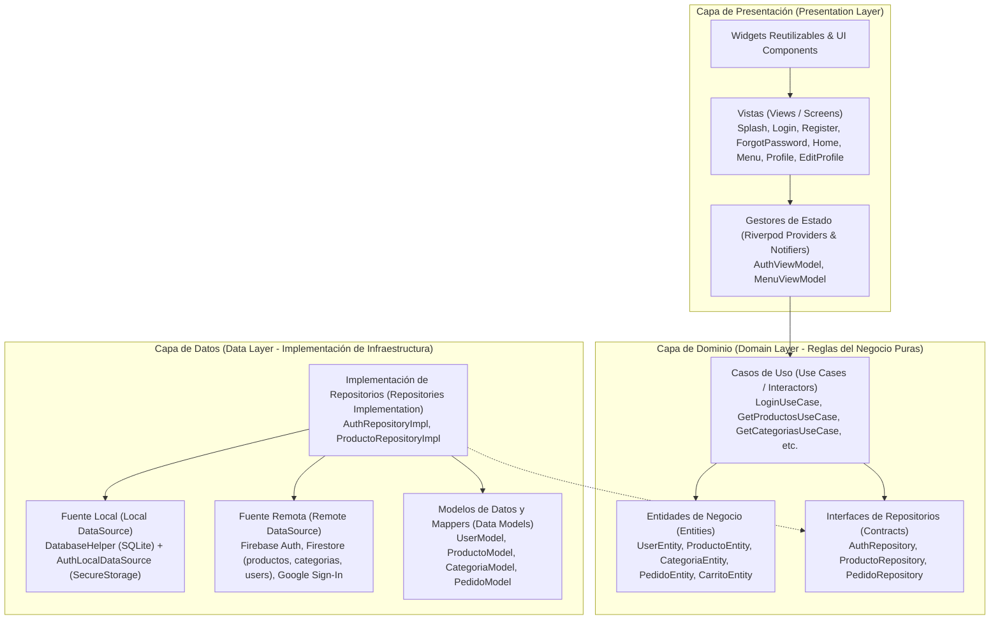

# CafeterIA ESCOM — Documento de Especificación, Arquitectura e Inicialización

**Asignatura:** Desarrollo de Aplicaciones Móviles Nativas (DAMN - 20271)  
**Institución:** Escuela Superior de Cómputo (ESCOM) — Instituto Politécnico Nacional (IPN)  
**Profesor Evaluador:** M. en C. José Alfredo Olivas Rivera (JAOR)  
**Proyecto:** Sistema de Pedidos en Línea y Gestión de Cafetería ESCOM  
**Versión:** 1.2.0 (Sprint 2 — Menú Digital y Persistencia Offline en SQLite Completado)  
**Fecha:** Noviembre 2026  

---

## 1. Visión General del Proyecto

**CafeterIA ESCOM** es una solución móvil integral de alto rendimiento desarrollada en Flutter/Dart, orientada a resolver las largas filas, tiempos de espera y desabasto de productos en la cafetería de la Escuela Superior de Cómputo.

La aplicación permite a los estudiantes y docentes consultar el menú en tiempo real (con soporte sin conexión), armar su pedido, personalizarlo, pagar o solicitar su preparación anticipada y recibir alertas cuando su orden esté lista para recoger. A su vez, otorga al personal de la cafetería un panel para administrar inventario, catálogo y el flujo de los pedidos.

---

## 2. Alineación con los Requerimientos Oficiales (DAMN - 20271)

El proyecto está diseñado bajo estricto apego al marco estándar y rúbrica de evaluación académica:

| Requerimiento | Especificación Académica | Implementación en CafeterIA ESCOM |
| :--- | :--- | :--- |
| **RF1: Usuarios y Autenticación** | Registro, inicio de sesión (correo/contraseña y OAuth), gestión de perfil, avatar, mantenimiento de sesión mediante tokens y recuperación de contraseña olvidada. | • Firebase Auth + Google Sign-In.<br>• Recuperación de contraseña (`ForgotPasswordScreen`).<br>• Perfil de usuario con actualización de fotografía y datos (`ProfileScreen` y `EditProfileScreen`).<br>• Manejo seguro de credenciales con `flutter_secure_storage`. |
| **RF2: Gestión de Datos (CRUD)** | Crear, Leer, Actualizar y Eliminar elementos del negocio con validación en tiempo real, confirmación previa de borrado, búsqueda por palabras clave, filtros por categoría y vista detallada. | • Catálogo dinámico en Cloud Firestore con sincronización en tiempo real.<br>• Base de datos local SQLite (`sqflite`) con tablas `productos_cache` y `categorias_cache` para funcionamiento 100% offline.<br>• Filtrado instantáneo por categorías y buscador multicriterio en vivo.<br>• Modal interactivo de detalle de producto con control de cantidades y stock. |
| **RF3: UI, Sensores y Notificaciones** | Persistencia local offline, integración con hardware (cámara/galería), notificaciones locales desencadenadas por acciones y navegación fluida mediante Menú Inferior (Bottom Bar). | • `image_picker` y `permission_handler` para fotografías de productos y avatar de usuario.<br>• `flutter_local_notifications` para alertar cuando el pedido cambia de estado (*"¡Tu orden está lista para recoger en caja!"*).<br>• Barra de navegación inferior con Material Design 3 (`HomeScreen`). |
| **RNF1: Rendimiento y Experiencia (UX)** | Pantallas cargan en < 2.0s, 60 fps estables sin bloquear hilo principal, interfaz responsiva a múltiples resoluciones y densidades (DPI), navegación intuitiva (máx. 3 toques) y feedback visual (spinners/skeletons). | • Arquitectura asíncrona reactiva con `Riverpod`.<br>• Shimmer skeletons (`shimmer`) y animaciones Lottie (`lottie`) para estados de carga.<br>• Flujos de navegación optimizados con `GoRouter`.<br>• Búsqueda y filtrado local indexado en SQLite en < 50ms. |
| **RNF2: Seguridad, Estabilidad y Código** | Arquitectura limpia (MVVM/Clean), código documentado, Git activo con commits periódicos, consumo RAM < 180 MB, tasa de fallos = 0% en demo, comunicación HTTPS/TLS y sin llaves hardcodeadas. | • Clean Architecture estricta en 3 capas desacopladas.<br>• Manejo funcional de errores con Either/Failures (`dartz`).<br>• Repositorio Git formal con commits semánticos periódicos.<br>• Cumplimiento estricto de linter (`flutter analyze` limpio, 0 issues). |

---

## 3. Arquitectura del Software (Clean Architecture)

El proyecto adopta **Clean Architecture** (Arquitectura Limpia) combinada con **Riverpod** para la gestión reactiva de estado y **GoRouter** para el enrutamiento declarativo.



### Principios arquitectónicos aplicados:
1. **Regla de Dependencia:** Las capas internas no conocen nada de las externas. El `Domain` es código Dart puro, sin importar frameworks UI ni drivers concretos de base de datos.
2. **Inversión de Dependencias (DIP):** La capa de Dominio define contratos abstractos (`ProductoRepository`, `AuthRepository`). La capa de Datos implementa estos contratos.
3. **Manejo Seguro de Errores con `Either<Failure, T>`:** Ninguna excepción no controlada rompe la UI; todas son transformadas en clases `Failure` que la UI traduce a mensajes claros para el usuario.
4. **Offline-First:** Al consultar datos, se intenta sincronización remota; si no hay conectividad, se responde inmediatamente desde la base de datos local SQLite.

---

## 4. Estructura del Árbol de Archivos

```
lib/
├── app.dart                                # Configuración global de MaterialApp y tema
├── main.dart                               # Punto de entrada de la aplicación
├── core/                                   # Utilidades globales y transversales
│   ├── constants/
│   │   ├── app_colors.dart                 # Paleta institucional IPN (guinda/oro/verde)
│   │   ├── app_routes.dart                 # Nombres y configuración de GoRouter
│   │   └── app_strings.dart                # Centralización de textos (i18n ready)
│   ├── errors/
│   │   └── failures.dart                   # Jerarquía de fallos (Server, LocalDatabase, Auth, Network)
│   ├── theme/
│   │   └── app_theme.dart                  # Temas Claro y Oscuro Material 3
│   └── utils/                              # Formateadores, validadores y helpers
├── domain/                                 # Capa de Dominio (Dart Puro)
│   ├── entities/                           # Modelos de negocio inmutables
│   │   ├── user_entity.dart
│   │   ├── producto_entity.dart            # ProductoEntity y CategoriaEntity
│   │   ├── carrito_entity.dart
│   │   └── pedido_entity.dart
│   ├── enums/                              # Enumeraciones del sistema
│   │   ├── estado_pedido.dart              # pendiente, confirmado, preparando, listo, entregado
│   │   └── metodo_pago.dart                # efectivo, tarjeta, transferencia
│   ├── repositories/                       # Contratos abstractos
│   │   ├── auth_repository.dart
│   │   ├── producto_repository.dart
│   │   └── pedido_repository.dart
│   └── usecases/                           # Lógica de aplicación
│       ├── auth/                           # Casos de uso de autenticación y perfil (RF1)
│       │   ├── check_auth_status_usecase.dart
│       │   ├── get_current_user_usecase.dart
│       │   ├── login_usecase.dart
│       │   ├── login_with_google_usecase.dart
│       │   ├── logout_usecase.dart
│       │   ├── register_usecase.dart
│       │   ├── send_password_reset_usecase.dart
│       │   └── update_profile_usecase.dart
│       ├── menu/                           # Casos de uso del catálogo y menú (RF2)
│       │   ├── get_categorias_usecase.dart
│       │   ├── get_productos_usecase.dart
│       │   └── search_productos_usecase.dart
│       ├── pedidos/
│       └── admin/
├── data/                                   # Capa de Datos
│   ├── datasources/
│   │   ├── local/                          # Almacenamiento seguro y base de datos SQLite
│   │   │   ├── auth_local_datasource.dart  # Manejo seguro con FlutterSecureStorage (RNF2)
│   │   │   ├── database_helper.dart        # SQLite helper, tablas y seed de cafetería
│   │   │   └── producto_local_datasource.dart # DAO y caché SQLite de productos/categorías
│   │   └── remote/                         # Servicios remotos en la nube
│   │       ├── auth_remote_datasource.dart # Firebase Auth + Firestore + Google Sign-In
│   │       └── producto_remote_datasource.dart # Colecciones productos/categorias Firestore
│   ├── models/                             # Modelos con serialización JSON / Map / SQLite
│   │   ├── user_model.dart                 # Mapeo de UserEntity <-> JSON / Firebase
│   │   ├── producto_model.dart             # Mapeo de ProductoEntity <-> SQLite / Firestore
│   │   └── categoria_model.dart            # Mapeo de CategoriaEntity <-> SQLite / Firestore
│   └── repositories/                       # Implementaciones concretas de Repositories
│       ├── auth_repository_impl.dart       # Orquestador local-remoto de autenticación
│       └── producto_repository_impl.dart   # Orquestador Offline-First del Menú
└── presentation/                           # Capa de Presentación
    ├── viewmodels/                         # Riverpod StateNotifiers y Providers
    │   ├── auth_state.dart
    │   ├── auth_viewmodel.dart
    │   ├── menu_state.dart                 # Estado inmutable del menú y filtros
    │   └── menu_viewmodel.dart             # StateNotifier y proveedores del catálogo
    ├── views/                              # Pantallas de la aplicación
    │   ├── splash/
    │   │   └── splash_screen.dart          # Verificación de sesión previa y bienvenida
    │   ├── auth/
    │   │   ├── login_screen.dart           # Login correo/contraseña y Google Sign-In
    │   │   ├── register_screen.dart        # Registro con validaciones reactivas
    │   │   └── forgot_password_screen.dart # Restablecimiento de contraseña
    │   ├── home/
    │   │   └── home_screen.dart            # Shell con NavigationBar interactivo
    │   ├── menu/
    │   │   └── menu_screen.dart            # Menú interactivo, buscador, filtros y detalle
    │   ├── cart/                           # Carrito de compras (Sprint 3)
    │   ├── orders/                         # Seguimiento de pedidos (Sprint 3)
    │   ├── profile/                        # Gestión de cuenta de usuario (Sprint 1)
    │   │   ├── profile_screen.dart         # Credenciales, detalles y acciones de cuenta
    │   │   └── edit_profile_screen.dart    # Modificación de nombre y selector de avatar
    │   ├── payment/
    │   └── admin/
    └── widgets/                            # Componentes UI reutilizables
```

---

## 5. Reporte Técnico de Inicialización (Sprint 0)

Acciones sobre el repositorio para configuración inicial, dependencias resueltas (`pubspec.yaml`), compatibilidad con Flutter 3.44+ y configuración de linter estricto.

---

## 6. Plan de Desarrollo por Sprints


---

## 7. Reporte Técnico de Desarrollo — Sprint 1: Módulo de Autenticación y Perfil (RF1)

- Se implementaron 8 casos de uso de autenticación.
- Persistencia de tokens en `FlutterSecureStorage` con hardware Keystore en Android.
- Conexión con `FirebaseAuth`, `GoogleSignIn` y `FirebaseFirestore` con fallback seguro para demo.
- Pantallas `SplashScreen`, `LoginScreen`, `RegisterScreen`, `ForgotPasswordScreen`, `ProfileScreen` y `EditProfileScreen`.

---

## 8. Reporte Técnico de Desarrollo — Sprint 2: Menú Digital y Persistencia Offline (RF2 + RF3)

El **Sprint 2** implementa el catálogo de productos y menú con arquitectura Offline-First y búsqueda instantánea:

### 8.1. Modelos de Datos Duales (Cloud Firestore + SQLite)
- **`ProductoModel`:**
  - `toJson()` / `fromJson()` para Cloud Firestore.
  - `toSqlite()` / `fromSqlite()` para tabla local `productos_cache`, mapeando booleanos numéricos (0/1).
  - Getter `puedeAgregarseAlCarrito` que valida stock disponible.
- **`CategoriaModel`:**
  - Persistencia relacional de categorías de la cafetería (`Desayunos`, `Comidas Corridas`, `Tortas y Baguettes`, `Bebidas`, `Cafetería`, `Snacks y Postres`).

### 8.2. Base de Datos Relacional Local (`sqflite`)
- **`DatabaseHelper`:**
  - Singleton con apertura controlada de la base `cafeteria_escom.db`.
  - Creación de tablas indexadas `categorias_cache` y `productos_cache`.
  - Carga automática (*Seed Data*) con productos reales de la cafetería de la ESCOM, precios en MXN e imágenes de muestra, garantizando que la aplicación funciona desde el primer arranque sin necesidad de conectividad a internet.
- **`ProductoLocalDataSourceImpl`:**
  - Consultas SQL optimizadas: `getCategorias`, `getProductos`, `getProductosByCategoria`, `buscarProductos` (con operador `LIKE`), `cacheCategorias`, `cacheProductos`.

### 8.3. Sincronización Transparente en `ProductoRepositoryImpl`
- Estrategia Offline-First:
  1. Consulta a Cloud Firestore. Si hay conexión y datos disponibles, actualiza la base de datos local SQLite en un lote asíncrono (`batch.commit`).
  2. Si no hay conexión o Firestore no está disponible, cae de inmediato a SQLite sin arrojar excepciones no controladas ni mostrar pantallas de error.

### 8.4. Interfaz de Usuario del Catálogo (`MenuScreen`)
- **Buscador Dinámico:** Campo de búsqueda en tiempo real conectado con `MenuViewModel.setSearchQuery(query)`.
- **Selector de Categorías Horizontal:** Chips interactivos (`ChoiceChip`) con icono y nombre (`Todos`, `🍳 Desayunos`, `🍲 Comidas`, etc.).
- **Tarjetas de Producto:** Foto del producto con fallback, título, descripción breve, precio en formato monetario institucional (`$48.00 MXN`) e indicador de stock.
- **Modal de Detalle (`_ProductDetailModal`):**
  - Desplegable interactivo (`showModalBottomSheet`) con imagen grande, descripción completa, selector numérico de piezas (+/-) limitado al stock disponible y botón con cálculo de precio total en vivo para agregar al carrito.

---

## 9. Verificación de Calidad y Pruebas Automatizadas

Se cuenta con una batería integral de pruebas unitarias y de widgets:

### 9.1. Pruebas Unitarias Ejecutadas (`flutter test`)
- **`test/unit/models/producto_model_test.dart` (6 pruebas):**
  - Subtipo de `ProductoEntity` $\rightarrow$ **Aprobada**
  - Serialización y deserialización JSON $\rightarrow$ **Aprobada**
  - Mapeo SQLite de booleanos (0/1) $\rightarrow$ **Aprobada**
  - Lógica de negocio `puedeAgregarseAlCarrito` $\rightarrow$ **Aprobada**
  - Subtipo de `CategoriaEntity` $\rightarrow$ **Aprobada**
  - Persistencia SQLite de categorías $\rightarrow$ **Aprobada**
- **`test/unit/viewmodels/menu_viewmodel_test.dart` (3 pruebas):**
  - Carga inicial de categorías y productos $\rightarrow$ **Aprobada**
  - Filtrado por categorías $\rightarrow$ **Aprobada**
  - Búsqueda por texto y coincidencia $\rightarrow$ **Aprobada**
- **`test/unit/models/user_model_test.dart` (4 pruebas):**
  - Serialización y subtipado de usuario $\rightarrow$ **Aprobadas**
- **`test/unit/usecases/auth_usecases_test.dart` (6 pruebas):**
  - Casos de uso de autenticación $\rightarrow$ **Aprobadas**
- **`test/unit/viewmodels/auth_viewmodel_test.dart` (7 pruebas):**
  - Estados reactivos de autenticación $\rightarrow$ **Aprobadas**
- **`test/widget_test.dart` (1 prueba):**
  - Smoke test de `CafeteriaApp` $\rightarrow$ **Aprobada**

> **Resultado global de pruebas:** **27/27 tests passed (100% de éxito).**

### 9.2. Análisis Estático de Código (`flutter analyze`)
- **Resultado:** **No issues found!** (0 errores, 0 advertencias, 0 sugerencias).

---

## 10. Próximos Pasos — Sprint 3: Carrito de Compras y Flujo de Pedidos (RF2, RNF1)
1. Estado global del carrito de compras reactivo (`CarritoNotifier` con Riverpod).
2. Cálculos automáticos de subtotal, IVA y total.
3. Creación del pedido en Firestore y generación de código de entrega (código alfanumérico / QR).
4. Pantalla de confirmación y seguimiento de pedido en tiempo real.
